# Dog Breed Explorer

An offline-first React Native app for browsing and filtering all **283** dog breeds from the [Dog API v2](https://dogapi.dog/docs/api-v2). Built with Expo SDK 58 · React Native 0.88 · TypeScript (strict).

| Breed list (light) | Breed list (dark) | Filters applied | Offline |
|---|---|---|---|
| 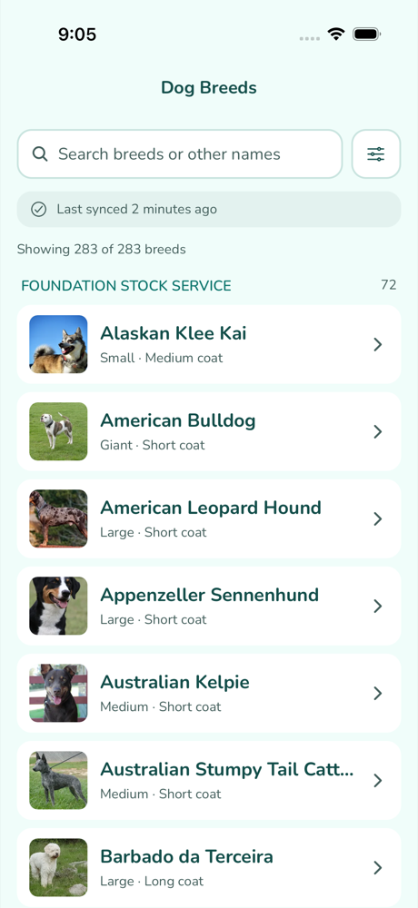 | 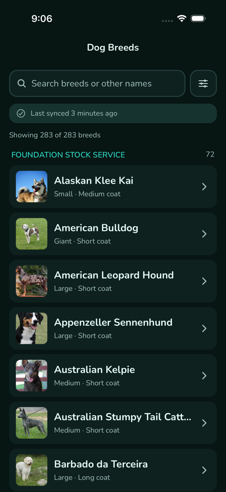 | 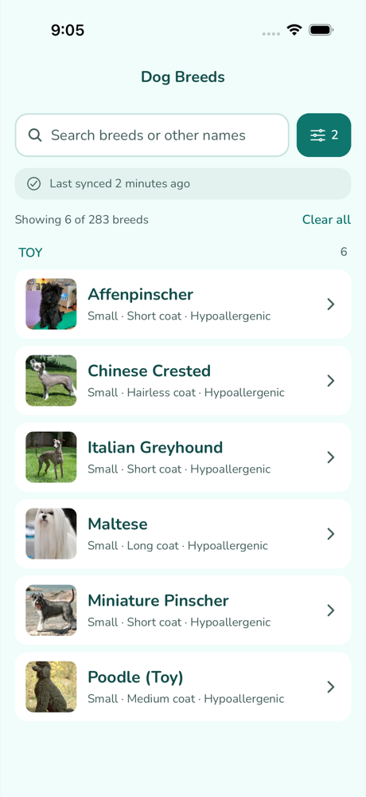 | 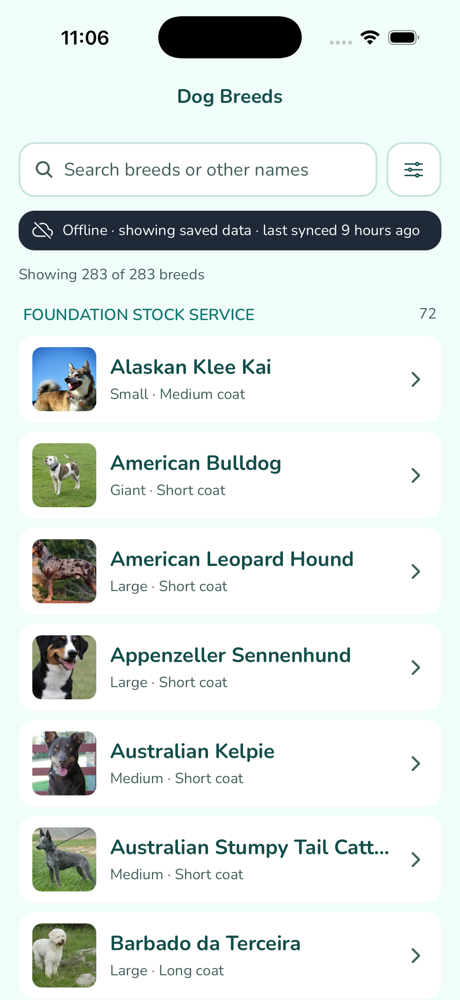 |

| Filter sheet | Traits | Gallery with attribution | Traits (dark) |
|---|---|---|---|
| 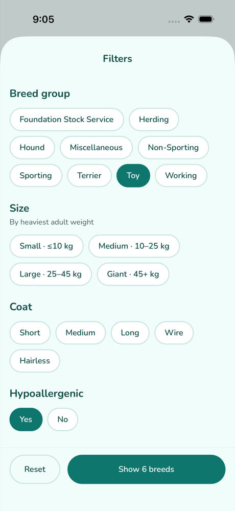 | 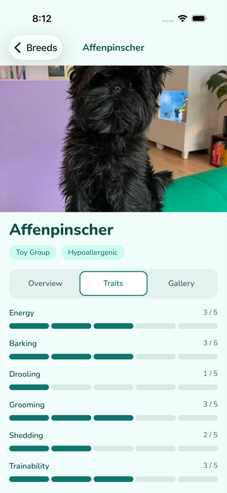 | 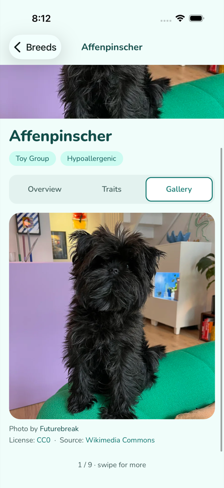 | 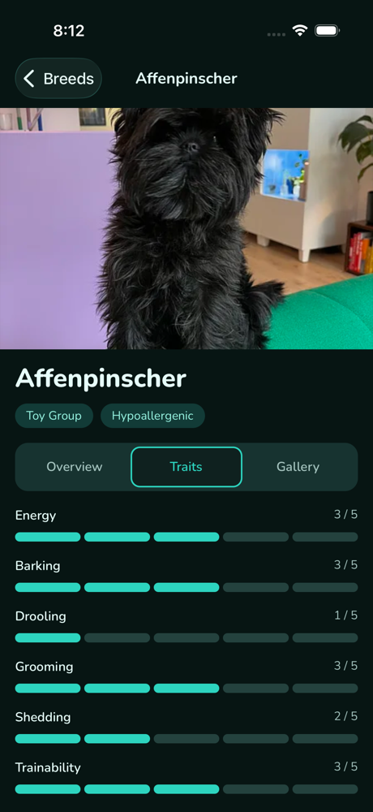 |

| Android: filters applied | Android: offline cold start |
|---|---|
| 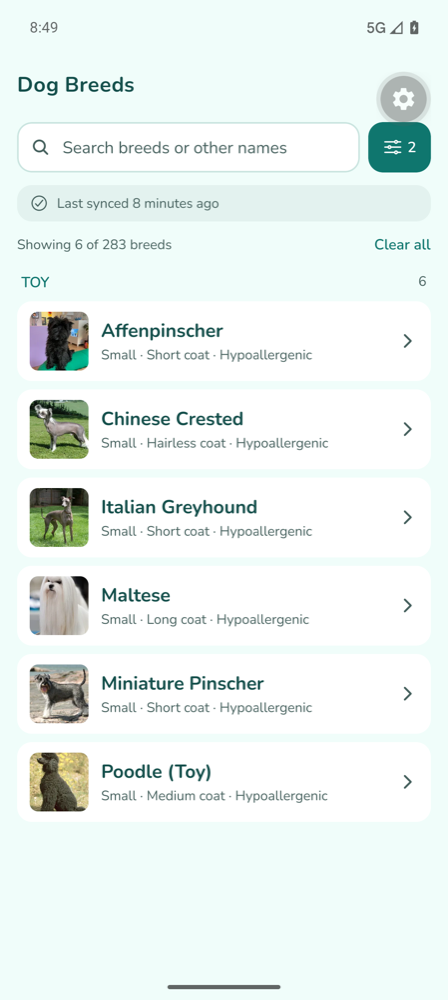 | 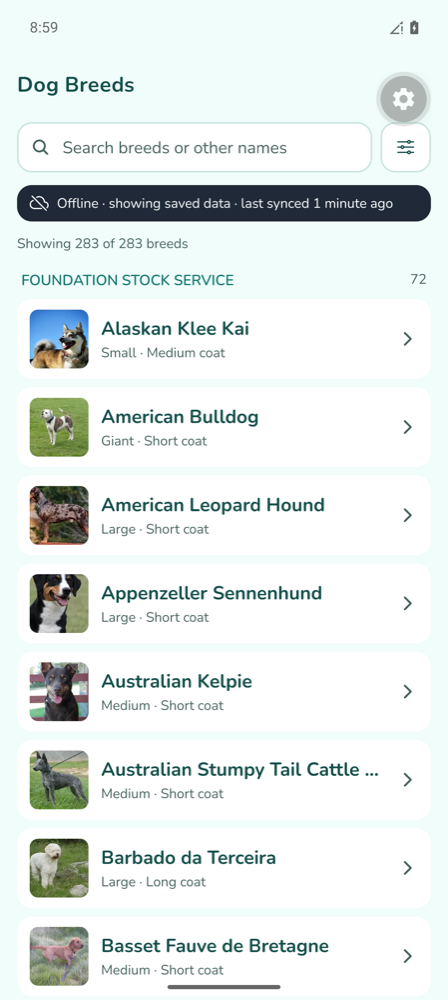 |

## Quick Start

```bash
npm install
cp .env.example .env      # optional: every variable has a default
npm run ios               # or: npm run android
```

This opens the app in **Expo Go** on the iOS Simulator or Android emulator. Every native module used ships in Expo Go, so there's no CocoaPods or Gradle step. On a clean machine with a simulator installed, it takes under 3 minutes.

```bash
npm test                  # 54 unit + component tests
npm run typecheck         # tsc --noEmit (strict + noUncheckedIndexedAccess)
npm run lint              # ESLint; @typescript-eslint/no-explicit-any is an error
maestro test .maestro/critical-flow.yaml    # E2E: search → detail tabs → gallery → filters
npx expo run:ios --configuration Release    # production build (used for PERFORMANCE.md)
```

## Features

- **All 283 breeds**, assembled from 6 pages of 48. They're grouped by breed group with sticky headers in one virtualized list (FlashList v2).
- **Debounced search** (250 ms) over the breed name **and `other_names`**, case- and accent-insensitive ("monkey terrier" finds the Affenpinscher).
- **Multi-select filters:** breed group (9), size band (small ≤ 10 kg · medium ≤ 25 · large ≤ 45 · giant), coat (short, medium, long, wire, hairless), hypoallergenic yes/no, and minimum scores for good with children / dogs / strangers. A live "Show N breeds" count updates as you pick.
- **Detail screen** with a sticky tab bar:
  - **Overview:** description, life span, male/female weight and height, origin (country, region, era), coat, other names, kennel clubs.
  - **Traits:** all 11 trait scores as segmented visual scales (exercise shown in min/day) plus temperament tags.
  - **Gallery:** swipeable, with **author · license · source** links on every photo.
- **Offline-first:** works fully offline after the first sync. Freshness banner ("Last synced 2 hours ago"), offline banner, partial-failure banner with Retry, pull-to-refresh, background sync on reconnect and on foreground.
- **Light and dark mode**, screen-reader labels throughout, 44 pt touch targets, deep links (`dogbreeds://breed/<id>?tab=Traits`).

## Architecture Overview

The app has three layers with one-way dependencies: **data → state → UI**.

- **Data layer** (plain TypeScript, no React): `fetchJson` adds a timeout and exponential backoff with jitter. `fetchAllBreeds` fetches page 1, then pages 2–6 in parallel, and merges them by id. `normalizeBreed` is the single trust boundary, where raw `unknown` JSON (empty height objects, null coats, "wire" hiding in `coat.type`, missing image authors) becomes a fully typed `Breed` with precomputed size band, coat tags and search text. SQLite stores the normalized records.
- **State:** one Zustand store holds normalized `breedsById` / `groupsById`, the sync status, and the filters. The sync service writes to it directly, outside React.
- **UI:** screens subscribe to small selectors. Grouping and filtering is a pure, unit-tested function that runs in memory (283 records filter in well under a millisecond). FlashList renders only the visible window, and each row reads a few precomputed scalars plus one 200 px thumbnail. Error boundaries wrap every screen and every detail tab.

On launch the app renders **from SQLite first** (13–20 ms, no network), then syncs in the background only if the data is stale. That's why it's interactive in about 2 s with or without a connection. Details are in [docs/ARCHITECTURE.md](docs/ARCHITECTURE.md).

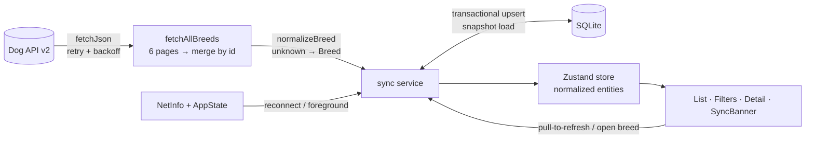

## Key Technical Decisions

Full rationale in [docs/DECISIONS.md](docs/DECISIONS.md).

- **State: Zustand.** It holds a normalized entity cache that the non-React sync service can read and write directly (`getState`/`setState`). Selector subscriptions stop the banner from re-rendering when filters change. The store is about 50 lines; Redux Toolkit's ceremony doesn't pay off at this size, and Context would re-render every consumer on every change.
- **Database: SQLite (expo-sqlite).** The ~1 MB dataset is too big for an AsyncStorage blob on Android (2 MB CursorWindow / 6 MB cap). WatermelonDB would need a native build and offers sync machinery a read-only catalogue doesn't need. Transactions keep a half-finished sync from ever being persisted. The DB is a cache of server data, so a schema bump just drops and re-syncs. **Only the synchronous expo-sqlite API is used:** a Release-build investigation with lldb showed the async API corrupting the Hermes heap from a background thread. The full story and evidence are in DECISIONS.md §3.
- **Offline sync strategy:** cache first, then network.
  - Hydrate from SQLite.
  - Sync when the cache is stale (6 h), on reconnect, on foreground, or on pull-to-refresh, with concurrent triggers sharing one in-flight run.
  - Partial page failures keep the cached data, never prune, and say exactly what's stale.
  - "Online" means the Dog API itself answers.
  - Images: list thumbs are prefetched to disk after each sync (~6 MB for all 283). Gallery uses `medium` on cellular and `large` on Wi-Fi. The multi-MB originals are never downloaded. Size caps are LRU (iOS: 150 MB disk / 32 MB memory; Android: Glide's 250 MB).
- **No React Query:** SQLite + Zustand already *is* the cache. React Query would be a second one to keep consistent. Retry, dedupe and refetch triggers come to about 60 lines.
- **Navigation:** React Navigation native-stack with a typed `RootStackParamList`. The detail tab lives in the route params, so deep links and taps share one source of truth.

## Performance Report

Measured on an iPhone 17 Pro simulator. Release = `expo run:ios --configuration Release`. Full methodology in [docs/PERFORMANCE.md](docs/PERFORMANCE.md).

| Metric | Target | Result |
|---|---|---|
| Cold start → interactive, cached data | < 3 s | **2.0–2.1 s** (Release, 8 runs, upper bound) |
| List scroll | 60 fps | **57.3 fps delivered, 93% of frames on time** (Release) · **60 UI / 60 JS** in RN Perf Monitor (dev) |
| Memory | < 150 MB | **78 MB at rest · 146 MB peak** after flinging all 283 rows (Release) |
| Bundle | n/a | **2.4 MB** Hermes bytecode · 1.52 MB JS (388 KB gzip) · 976 KB assets · app code 39 KB |

**Bundle size breakdown** (minified JS, from `npm run bundle:analyze`): react-native 40% · expo 6% · react-navigation ~12% across its packages · FlashList 5% · react-native-screens 3% · app code 2.7%. Switching icons and fonts to deep imports **cut assets from 6.1 MB to 976 KB**.

| Profiler, full list mid-fling (RN Perf Monitor, dev) | Memory during the full 283-row scroll (Release) |
|---|---|
|  |  |

*The Perf Monitor's "RAM 348 MB" covers the entire Expo Go process (its launcher app plus dev tooling); the Release footprint is the chart on the right.*

## Testing

- **Unit + component tests (54, `npm test`):**
  - Normalization of real API records and messy variants
  - Size bands, filters and grouping
  - Retry/backoff timing
  - 6-page merge with duplicates and partial failure
  - Sync outcomes (complete / partial / failed / offline / deduped / reconnect)
  - SQLite cache layer (sync-API-only guard, transactions, prune)
  - SyncBanner states, trait scales
- **E2E (Maestro):** `.maestro/critical-flow.yaml` covers list load → search by other name → detail → all three tabs → gallery attribution → back → filters → result count and active-filter badge.
- **CI:** `.github/workflows/ci.yml` runs typecheck, lint and tests on every push and PR.

## Environment

See [.env.example](.env.example): `EXPO_PUBLIC_DOG_API_BASE_URL`, `EXPO_PUBLIC_PAGE_SIZE`, `EXPO_PUBLIC_STALE_AFTER_MINUTES`, `EXPO_PUBLIC_IMAGE_DISK_CACHE_MB`. All are optional, with defaults in `src/config.ts`.

## Known limitations

- Sync doesn't run while the app is killed (no background task). It runs on launch, foreground and reconnect. That's enough for a catalogue that rarely changes; see DECISIONS.md §13.
- Performance was profiled on iOS (Release). On Android (Pixel 9 Pro emulator, Expo Go) the E2E critical flow passes and an offline cold start serves all 283 breeds and their thumbnails from cache, but no Android Release build was profiled.
