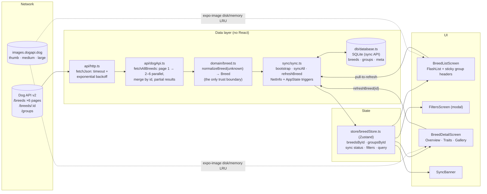

# Architecture

## System overview



## Data flow: API → Cache → UI

**Cold start (works offline):**
1. `App` calls `bootstrap()`.
2. `loadSnapshot()` reads the normalized breeds, groups and `lastSyncedAt` from SQLite (13–20 ms).
3. The store is hydrated, so the list renders straight from cache.
4. Only then, and only if the cache is stale (> 6 h), never synced, or the last sync errored, `syncAll()` runs in the background.

**Sync:**
1. `fetchAllBreeds()` fetches page 1, learns the page count, then fetches pages 2–6 in parallel. Each page retries independently.
2. Every page is normalized (`unknown` → `Breed`) and streamed into the store as it arrives, so a first launch shows breeds after one round-trip.
3. Pages are merged by id, then saved in one SQLite transaction.
4. A **complete** snapshot prunes removed breeds and stamps `lastSyncedAt`. A **partial** one never deletes anything and reports "Updated 4 of 6 pages".
5. List thumbnails are prefetched to disk, so the next offline launch has images.

**Reading:** screens subscribe to the store with selectors. The list derives grouped, filtered items with `buildListItems()`, a pure function (unit-tested) that runs in memory, not SQL. Detail screens read one record by id and quietly refresh it via `GET /breeds/:id`.

**Connectivity:** "online" means NetInfo's probe of `HEAD {API}/groups` succeeds. Going offline → online, or returning the app to the foreground, re-checks staleness and syncs if needed.

## Module boundaries

| Layer | Folder | Depends on | Must not depend on |
|---|---|---|---|
| Domain | `src/domain` | nothing | React, RN, network, storage |
| API | `src/api` | domain, config | store, DB, UI |
| Persistence | `src/db` | domain | store, API, UI |
| Orchestration | `src/sync` | api, db, store | UI |
| State | `src/store` | domain | api, db, UI |
| UI | `src/features/*`, `src/ui` | store, domain, sync (actions only) | api, db |

The domain and API layers are plain TypeScript and fully unit-tested without React. Screens never call `fetch` or SQLite directly, so swapping SQLite or the API client touches one folder.

## Folder structure

```
src/
├── api/            http.ts (fetchJson + backoff) · dogApi.ts (endpoints, pagination)
├── db/             database.ts (schema, snapshot load, transactional saves)
├── domain/         breed.ts (types, normalizeBreed, size bands) · filters.ts (filter + grouping)
├── features/
│   ├── breeds/         BreedListScreen · BreedRow · FiltersScreen · SyncBanner
│   └── breed-detail/   BreedDetailScreen · OverviewTab · TraitsTab · GalleryTab
├── lib/            format.ts (timeAgo, ranges, titleCase)
├── navigation/     RootNavigator.tsx (typed param list, deep links)
├── store/          breedStore.ts (Zustand, normalized entities)
├── sync/           sync.ts (bootstrap, syncAll, refreshBreed, connectivity)
├── ui/             theme.ts (tokens, light/dark) · Text · Chip · ErrorBoundary
└── __tests__/      unit + component tests (jest-expo, Testing Library)
.maestro/           E2E critical flow, screenshot and perf flows
```

**Scaling it:** a new feature (e.g. favourites) adds `src/features/favourites/`, a slice in the store, and, if it persists, a table plus a real migration in `db/`, because favourites would be the app's first *user* data. Everything else stays untouched.

## Error handling

| Failure | Where it's caught | What the user sees |
|---|---|---|
| Network down / API unreachable | NetInfo reachability → store | "Offline · showing saved data · last synced 2 hours ago" |
| Page 1 fails after retries | `runSync` | Warning banner + Retry, cached data stays |
| Some pages fail | `fetchAllBreeds` → partial snapshot | "Updated 4 of 6 pages. Some breeds may be out of date." + Retry |
| Malformed record | `normalizeBreed` | Record skipped, or field shows "Unknown" |
| Unreadable cache | `bootstrap` try/catch | Empty start; the sync refills it |
| Render crash in a screen or tab | `ErrorBoundary` per screen + per tab | "Something went wrong" + Try again; other tabs keep working |
