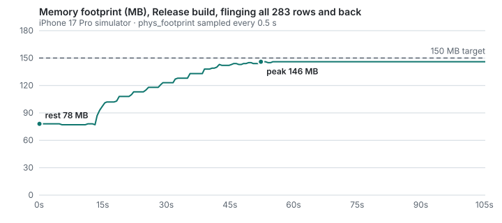
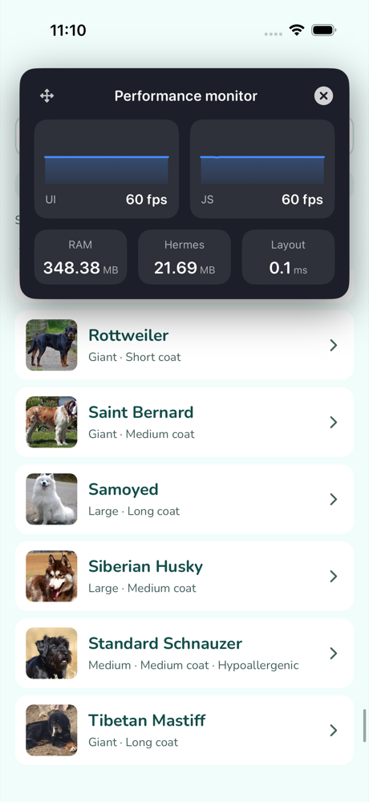

# Performance

All numbers below were measured on this codebase, on an **iPhone 17 Pro simulator (iOS 26.0)** on an Apple-silicon MacBook Pro. "Release" means `npx expo run:ios --configuration Release` (Hermes bytecode, no dev tooling). "Dev" means Expo Go with the dev bundle, which is slower and heavier, so dev numbers are pessimistic. Every method is stated so it can be re-run.

## Summary vs. targets

| Target | Result | Build | Method |
|---|---|---|---|
| Initial load < 3 s to interactive (cached data) | **2.0–2.1 s** (8 runs, 1.97–2.10 s) | Release | Maestro `launchApp` → "Showing 283 of 283 breeds" visible. Includes Maestro's polling, so it's an upper bound |
| 60 fps list scroll | **57.3 fps** delivered while moving, median frame 16.7 ms, p95 23.3 ms, **93.0%** of frames on time | Release | Screen recording while Maestro flings through all 283 rows and back; frame intervals from video timestamps (below) |
| 60 fps list scroll | **UI 60 fps / JS 60 fps** mid-fling | Dev | RN Perf Monitor overlay (screenshot below) |
| Memory < 150 MB | **77–78 MB at rest, 146 MB peak** after flinging all 283 rows and back (4 runs, identical peak) | Release | `footprint -p <pid>` every 0.5 s |
| JS heap | **21.7 MB** Hermes heap mid-fling | Dev | RN Perf Monitor |

## Bundle

Measured with `npx expo export --platform ios` (shipped Hermes bytecode) and `npm run bundle:analyze` (plain-JS export + source-map-explorer, which writes `dist-analyze/report.html`).

| Artifact | Size |
|---|---|
| **Hermes bytecode bundle (shipped)** | **2.4 MB** |
| Minified JS (pre-bytecode) | 1.52 MB · **388 KB gzipped** |
| Assets (fonts + icon font) | 976 KB (21 files) |

**Breakdown of the minified JS (1.52 MB):**

| Package | Size | Share |
|---|---|---|
| react-native | 593.9 KB | 40.0% |
| [unmapped runtime/polyfills] | 106.7 KB | 7.2% |
| expo | 91.3 KB | 6.2% |
| @react-navigation/core | 87.6 KB | 5.9% |
| @shopify/flash-list | 70.9 KB | 4.8% |
| [no source] | 50.3 KB | 3.4% |
| @react-native/virtualized-lists | 48.7 KB | 3.3% |
| react-native-screens | 48.4 KB | 3.3% |
| **app code (src/ + App.tsx)** | **39.4 KB** | **2.7%** |
| @react-navigation/elements | 32.0 KB | 2.2% |
| whatwg-url-minimum | 29.5 KB | 2.0% |
| @react-navigation/native | 23.0 KB | 1.5% |
| expo-sqlite | 21.6 KB | 1.5% |
| @react-navigation/routers | 19.0 KB | 1.3% |

**Optimization found by measuring:** the first export shipped **6.1 MB of assets (51 files)** and 1.96 MB of JS. Importing `@expo/vector-icons` and `@expo-google-fonts/nunito` from their package roots pulls in *every* icon font and all 18 Nunito weights. Switching to deep imports (`@expo/vector-icons/Ionicons`, `@expo-google-fonts/nunito/400Regular`, …) cut assets to **976 KB** (−84%) and JS to 1.52 MB (−22%).

## Memory during scroll (Release)



| Phase | Footprint |
|---|---|
| At rest, list on screen | 78 MB |
| Peak, after flinging all 283 rows down and back up | 146 MB |
| Steady state after the fling | 146 MB (plateau, no further growth) |

`footprint` breakdown, rest → peak: decoded image bitmaps (`CG raster data`) 3 → 33 MB, system/dyld 2 → 16 MB, malloc heaps +~20 MB, Hermes/VM +7 MB. Growth is bounded: it plateaus once every thumbnail has been decoded once.

Tuning that came from these measurements:

- `Image.configureCache({ maxMemoryCost: 32 MB })` (was 64 MB): peak **158 → 146–148 MB**.
- List thumbnails use the 200 px `thumb` variant (~20 KB webp, ~160 KB decoded), never `medium`/`large`.
- Tested `cachePolicy="disk"` for list thumbs as well. In like-for-like runs it made **no measurable difference** to peak memory or FPS, so the default `memory-disk` stayed. (One earlier run read 128 MB, but it wasn't reproducible: a fast fling can outrun thumbnail loading, so fewer images get decoded.)

## Frame pacing (Release)

The Animation Hitches instrument isn't supported on the simulator, so frame delivery was measured from a screen recording (`xcrun simctl io booted recordVideo`) while Maestro flung through the whole list and back (`.maestro/perf-scroll-release.yaml`). The simulator encoder emits a frame only when the screen changes, so during continuous motion the interval between frames is the rendered frame time. Intervals ≥ 100 ms (no motion between swipes) are excluded.

| Frame interval | Share of 3,004 intervals |
|---|---|
| ≤ 20 ms (on time at 60 Hz) | **93.0%** |
| 20–37 ms (one dropped frame) | 5.9% |
| > 37 ms (two or more dropped) | 1.1% |
| Effective rate while moving | **57.3 fps** |

## RN Perf Monitor (dev build, mid-fling)

| Mid-scroll | End of list |
|---|---|
|  |  |

UI 60 fps · JS 60 fps · Hermes heap 21.7 MB. The overlay's "RAM 348 MB" is the **whole Expo Go process** (Expo Go's own launcher app, dev tools, the unoptimized dev bundle), not this app. The Release numbers above are the real ones.

## Profiler: full 283-breed list render

What the JS thread does on a cold start with cache (sync SQLite read + `JSON.parse` of 283 rows: **13–20 ms**, measured with `performance.now()` in dev), then grouping and filtering in `buildListItems` (283 records, well under 1 ms). FlashList then renders only the visible window, about 10 rows plus a recycle buffer. The 283 rows are never all mounted, which is why the cost of each heavy record (DECISIONS.md §8) never multiplies.

Background sync's synchronous SQLite save (283 rows, one transaction) takes **23–36 ms** in dev, once per sync. That's the one JS-thread block in the data path (see DECISIONS.md §3 for why it's synchronous).

## Stability (Release)

| Scenario | Result |
|---|---|
| Cold launches with cache, PID alive after 8 s | 80/80 |
| Launches running a full 6-page sync each time | 30/30 |
| Maestro stress: 5 × (relaunch → pull-to-refresh → "Last synced just now") | 3/3 rounds |

Before the switch to the synchronous SQLite API, the same build died on ~8% of cold starts and failed every stress round (DECISIONS.md §3).

Measurements were taken with no other simulator or emulator running: with an Android emulator booted alongside, one cold start took 3.6 s and on-time frames dropped to 90%.

## Reproduce

```bash
npm run bundle:analyze                                     # bundle breakdown → dist-analyze/report.html
npx expo run:ios --configuration Release                   # Release build on the simulator
xcrun simctl launch booted ai.tripare.dogbreeds
maestro test .maestro/perf-scroll-release.yaml             # scroll run (sample `footprint -p <pid>` alongside)
maestro test .maestro/cold-start.yaml                      # cold start, cached data
```
